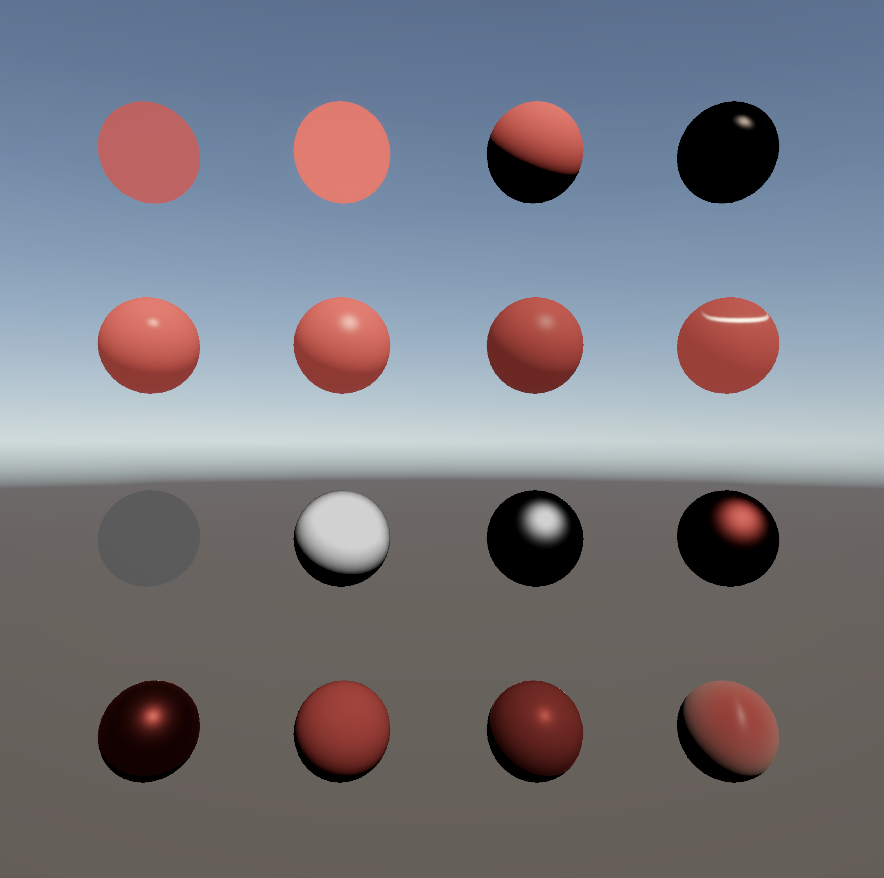

# はじめに
プログラムワークショップⅣの第3回の管理用です

# 結果画像

- 工夫した点：Shader_16_MyShaderで、授業のPBR（Shader_15）を次のように拡張した
  - PBRの異方性対応：法線分布関数と幾何減衰項を異方性GGXにして、接ベクトル方向と従法線方向の粗さ（Roughness X / Y）を別々に設定できるようにした
  - テクスチャ対応：Base Mapのテクスチャの色をベースカラーとして拡散反射に使えるようにした
  - 布の質感：Charlieシーン分布とNeubeltの可視関数で、布の縁がふわっと光る反射を追加し、Clothパラメータで金属っぽい質感から布の質感まで切り替えられるようにした

# 進め方

- 本リポジトリをforkしてください。
- fork先のリポジトリを更新してください
- Unityのプロジェクトをsrc内で進めて下さい。
- 結果を画面キャプチャして、画像としてリポジトリに追加して、上記のリンクから見れるようにしてください。
- 完成したら本リポジトリのmainブランチにpull requestを投げてください
